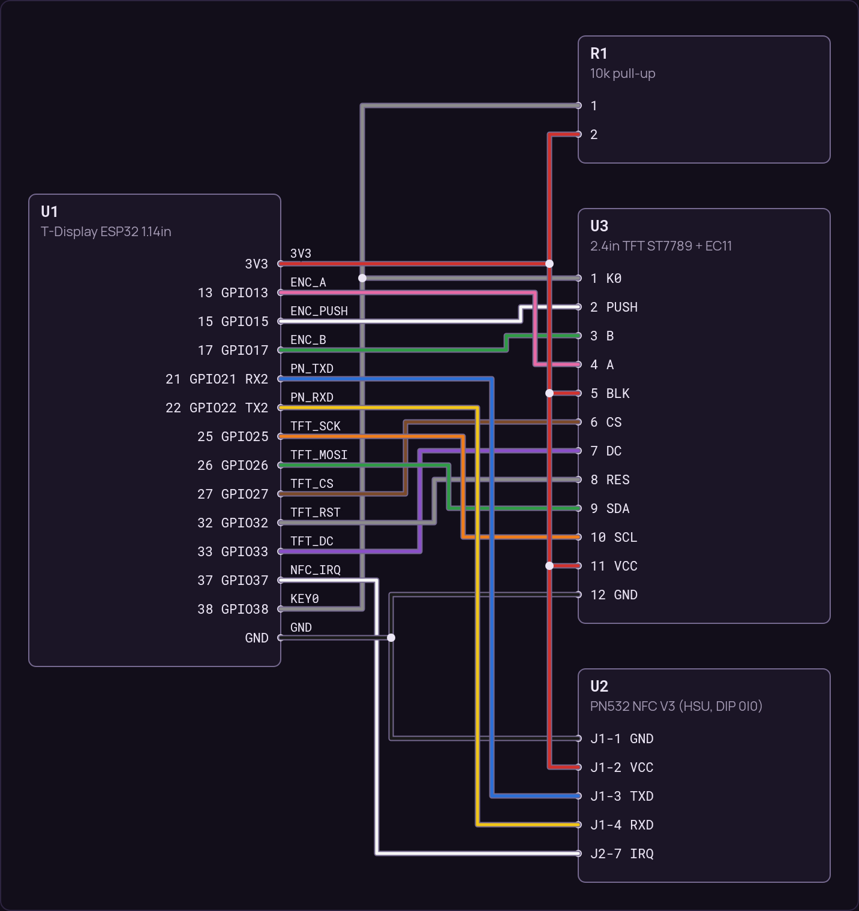

# nfc-tag-manager

A retro, SNES-styled NFC/RFID tag manager for an **ESP32 + PN532 + 2.4" ST7789
TFT with an EC11 rotary encoder**. Read, write, clone and inspect 13.56 MHz
MIFARE cards from a self-contained handheld, driven entirely by the knob.



## Hardware

| Part | Role |
| --- | --- |
| ESP32 (CH9102, T-Display-class board) | MCU |
| PN532 (Elechouse V3 clone) | 13.56 MHz NFC front end, **HSU/UART mode** |
| 2.4" ST7789 240×320 + EC11 | display + rotary knob + K0 button |

The PN532 runs over **UART (HSU), DIP switches `0|0`** — I2C mode never
answered on this board. Wiring is in [`docs/wiring/`](docs/wiring/): the PN532's
TXD → GPIO21 (Serial2 RX), RXD → GPIO22 (Serial2 TX), 115200 baud.

Controls:

- **Turn knob** — move / change value
- **Press knob** — select / OK
- **K0** — back / cancel

## Features

- **View info** — UID, type, frequency (13.56 MHz HF), protocol, SAK, ATQA, size
- **Read full** — per-sector dictionary attack, saves found keys to flash (NVS)
- **Hex view** — every block, hex + ASCII, trailer/locked markers
- **Write block** — single-block write (refuses trailers and block 0)
- **Clone card** — guided SOURCE → read → TARGET → write wizard; detects magic
  cards (Gen1a/Gen2/Gen4) and copies the UID when the target allows it
- **Magic check** — Gen1a/Gen4 detection
- **Erase data** — zero all data blocks (keeps UID and keys)

Long operations (read/clone/erase) show a progress bar and can be cancelled with K0.

## Layout

```
firmware/   PlatformIO project (the real firmware)
  src/      board.h, theme.h (SNES dark), pixelfont.h (Press Start 2P),
            pn532.h, keystore.h, card.h, input.h, gfx.h, ui.h, main.cpp
hwtest/     standalone bring-up sketches: PN532 probes, magic-card detector
docs/       wiring diagrams (Wiredex-style)
```

## Build & flash

```bash
cd firmware
pio run -t upload          # build and flash over USB (/dev/ttyACM0)
pio device monitor         # 115200 baud
```

The firmware targets the 2.4" TFT (`env:tft24`). Theme follows the personal
SNES-dark look (Press Start 2P pixel font, 16-colour palette).
